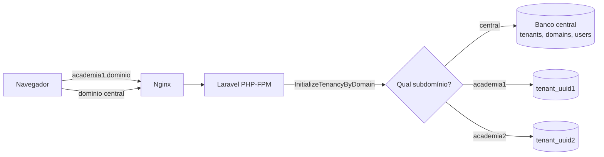

# Academia Multitenant

SaaS de gestão de academias em que **várias academias usam o mesmo sistema, cada uma com seu próprio banco de dados e subdomínio**. Uma área central cadastra as academias; cada academia gerencia seus alunos, planos e identidade visual sem enxergar dados das outras.

**Stack:** Laravel 12 · stancl/tenancy 3 · Inertia.js · Vue.js · Vite · MySQL 8 · Nginx · Docker Compose

<!-- Coloque aqui 2 ou 3 screenshots ou um GIF: painel central, dashboard de uma academia e cadastro de aluno. -->

## Funcionalidades

**Área central** (`academia-multitenant.test`)
- Login do administrador da plataforma
- Cadastro, edição e remoção de academias (tenants), com CNPJ e endereço
- Ao criar uma academia, o sistema cria o banco dela, roda as migrations e registra o subdomínio

**Área de cada academia** (`academia1.academia-multitenant.test`)
- Login próprio, separado do login central
- Dashboard
- Cadastro de alunos e de planos
- Upload da logo da academia
- Páginas próprias para academia não encontrada ou desativada

## Arquitetura



1. Toda requisição passa pelo middleware `InitializeTenancyByDomain`, que procura o subdomínio na tabela `domains` do banco central.
2. Encontrado o tenant, os *bootstrappers* do stancl/tenancy trocam a conexão do banco e isolam também **cache, arquivos e filas** daquela academia.
3. `PreventAccessFromCentralDomains` impede que as rotas de academia respondam no domínio central, e vice-versa.
4. Cada lado tem seu próprio guard de autenticação (`auth` no central, `auth:tenant` nas academias), então uma sessão nunca vale no outro contexto.

## Decisões técnicas

**Um banco por academia, e não uma coluna `tenant_id`.**
Com banco separado, um `where` esquecido não vaza dados entre clientes, o backup e a exclusão de um cliente são simples e dá para mover um cliente grande para outro servidor. O custo é mais bancos para administrar e migrations que precisam rodar em todos eles. Para um SaaS com poucas dezenas de academias, o isolamento vale mais que esse custo.

**Identificação por subdomínio.**
Cada academia ganha um endereço próprio, o que também facilita personalização (logo) e, no futuro, domínio próprio do cliente. A alternativa por caminho (`/academia1/...`) exigiria passar o tenant em todas as rotas.

**IDs em UUID para os tenants.**
Evitam IDs sequenciais previsíveis e geram nomes de banco únicos (`tenant<uuid>`).

**Criação de tenant em uma camada de serviço (`TenantService`).**
A lógica de criar o tenant, o domínio e o banco fica fora do controller e é reaproveitada pelo seeder e pela tela de cadastro.

**Inertia + Vue em vez de API + SPA separada.**
O sistema é um painel administrativo; Inertia dá a experiência de SPA sem manter duas aplicações e duas camadas de autenticação.

## Como rodar

Pré-requisitos: Docker e Docker Compose.

```bash
git clone https://github.com/GuilhermeRisson/academia-multitenant.git
cd academia-multitenant
cp .env.example .env
docker compose up -d --build

docker compose exec app composer install
docker compose exec app php artisan key:generate
docker compose exec app php artisan migrate --seed
```

O container `node` já instala as dependências e roda o Vite.

Configure o arquivo de hosts (no Windows, `C:\Windows\System32\drivers\etc\hosts`, como administrador; no Linux/macOS, `/etc/hosts`):

```
127.0.0.1 academia-multitenant.test
127.0.0.1 academia1.academia-multitenant.test
127.0.0.1 academia2.academia-multitenant.test
```

### Acessos de demonstração (dados fictícios do seeder)

| Área | URL | Login | Senha |
|---|---|---|---|
| Central | http://academia-multitenant.test:8080 | admin@example.com | password123 |
| Academia 1 | http://academia1.academia-multitenant.test:8080 | academia1@gmail.com | 123456 |
| Academia 2 | http://academia2.academia-multitenant.test:8080 | academia2@gmail.com | 123456 |

### Containers

| Serviço | Função | Porta |
|---|---|---|
| app | Laravel (PHP-FPM) | 9000 |
| mysql | MySQL 8 | 3307 |
| nginx | Servidor web | 8080 |
| node | Vite | 5175 |

### Problema comum

Se a criação de academias falhar por permissão, o usuário do MySQL precisa poder criar bancos:

```sql
GRANT ALL PRIVILEGES ON *.* TO 'laravel'@'%';
FLUSH PRIVILEGES;
```

## Testes

```bash
docker compose exec app php artisan test
```

## Próximos passos

- [ ] Testes de isolamento: usuário da academia 1 não acessa dados nem rotas da academia 2
- [ ] Testes do fluxo de criação de tenant (banco, migrations e domínio)
- [ ] Controle de mensalidades e check-in de alunos
- [ ] Deploy de demonstração online
